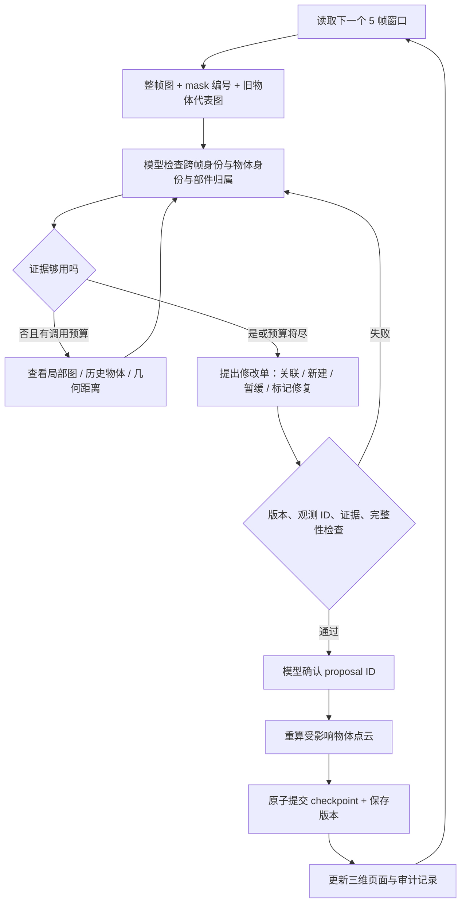

# 增量式场景理解 Harness 初版

输入是既有类别、mask 和对应的世界坐标点，不重新调用分割。每 5 个抽样帧为一个窗口；模型每窗审阅图像并决定观测属于旧物体、新物体，还是暂缓。

```bash
cd /home/seer/wzt/Reconstruction/InstanceRecognition
taskset -c 0 .venv/bin/python -m src.harness.run --prepare-only
taskset -c 0 .venv/bin/python -u -m src.harness.run
```

默认测试抽样序号 0–29（30 帧），输出到 `runtime/experiments/harness_first30_v1`。命令重复执行从最后成功 checkpoint 继续；改变参数或输入需要换 `--output`。密钥由 `/home/seer/wzt/API/.env` 加载，日志不保存密钥或图像 base64。

## 按程序执行顺序

1. `run.py` 加独占锁，校验配置及输入哈希。
2. `observations.py` 读取已有 NPZ，将每个 mask 保存为不可变观测（如 `0006:003`），准备带编号的整帧图和局部图。
3. 为当前窗口组织新观测、历史物体表及代表图。只有当前与过去观测可被工具访问。
4. `client.py` 调用配置的网关模型。模型可反复调用 `tools.py` 的工具查看证据。
5. `state.py` 验证模型提交的修改单，产生独立的新状态与受影响物体列表。错误返回给模型修正，不改已有状态。
6. 模型确认 proposal ID 后，`publish.materialize` 从原始观测重算受影响物体的体素点云；无变化的点云复用。全部生成成功后才切换 checkpoint。
7. `publish.py` 生成三维回放和审计页面，然后处理下一窗口。



## 六个工具实际做什么

| 工具 | 输入 → 输出 |
|---|---|
| `list_objects` | 无参数 → 旧物体、成员观测、代表观测、未决观测 |
| `inspect_observations` | 最多 4 个观测 ID → 局部图和观测信息 |
| `inspect_object` | 物体 ID → 成员信息与最多 3 张代表图 |
| `compare_geometry` | 两个观测 ID → 双向最近点距离、5cm 内比例 |
| `propose_update` | JSON 修改单 → 校验后的预览、受影响物体、proposal ID |
| `commit_update` | proposal ID → 请求提交通过检查的版本 |

修改单支持 create、assign（含改归属）、defer、repair、merge。成双或成组语义由 object_label 表达；当前不维护 Object 间关系边。`repair` 只标记需修复的 mask，本版不会自动拆分像素。

## 输出与边界

- `index.html`：每窗末帧与累计物体点云；`audit.html`：全部改动、原因和图像证据。
- `versions/`：不可变状态、修改单及逐物体点云；`checkpoint.json`：最后提交版本。
- `calls/`：脱敏请求、回答、工具结果、耗时与 token；`evidence/`：实际查看的图。
- `objects/`：当前最终候选的 PLY；`summary.json`：完成状态和统计。

这是增量身份关联原型。几何固定为已有全视频 GT 校正 AMB3R 点云，没有实现在线相机/尺度恢复。模型不使用物体级 GT 标签。候选数量、多帧出现和成功提交都不能代表识别准确率。点云是已观测表面的体素采样，不是完整实体体积；未实现可见性推理、自动 mask 修复、逐体素冲突评估或 GT 定量指标。

当前每窗提供每个历史物体的代表图，适合前 30 帧试验；长序列需要进一步限制上下文。每窗最多 14 次 API 往返，每次最多 3 次请求尝试；超预算或失败保留已提交版本，当前窗口可重新运行。

## 输入证据 v2（2026-09-21）

- 原始 RGB 与整帧彩色 mask overlay 成对发送；inspect_observations / inspect_object 也返回完整画面的 RGB 与目标 overlay，不裁剪。
- 同帧各 mask 使用不同颜色，并提供 overlay_color_rgb；颜色不是跨帧身份或真实外观。
- 每个观测新增 bbox_xyxy、image_size_wh、bbox_convention。坐标为原始 RGB 像素，左上原点，右下边界 exclusive；只描述可见 mask，空 mask 为 null。
- 默认输出改为 runtime/experiments/harness_first30_v2；旧证据目录拒绝覆盖。此前 v1 回放仍展示历史实际请求。
- runtime/experiments/harness_input_v2_preview/index.html 展示前五帧新版输入，仅执行 prepare-only，未运行新版模型推理。

### 输入 v3

当前窗口按帧交错排列观测摘要、原始 RGB、整帧 overlay。overlay 仅标类别；观测 ID 保留在文字中，用 bbox 与颜色对应，歧义时按需查看整帧目标高亮。工具图片对之前显式标记观测信息及工具调用 ID。模型字段使用白名单；本地路径、mask bit 等只保留在审计数据。几何摘要为同一世界坐标系下的可见表面点（米），不代表完整物体。API 轮次预算不等于工具调用次数。

首窗重跑：`python -m src.harness.run --frames 5 --window 5 --output runtime/experiments/harness_window01_v3`。旧实验不覆盖。输入审阅页：`python -m src.visualization.build_harness_input_review runtime/experiments/harness_window01_v3`（完成调用后生成）。
